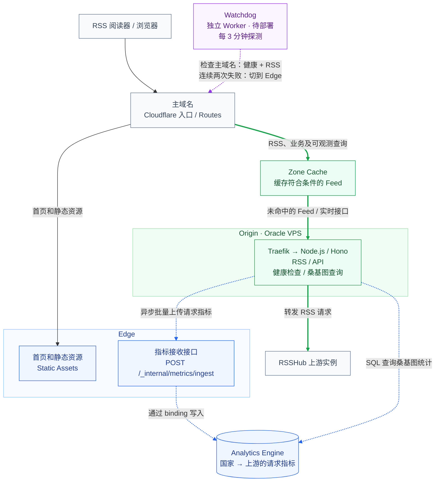
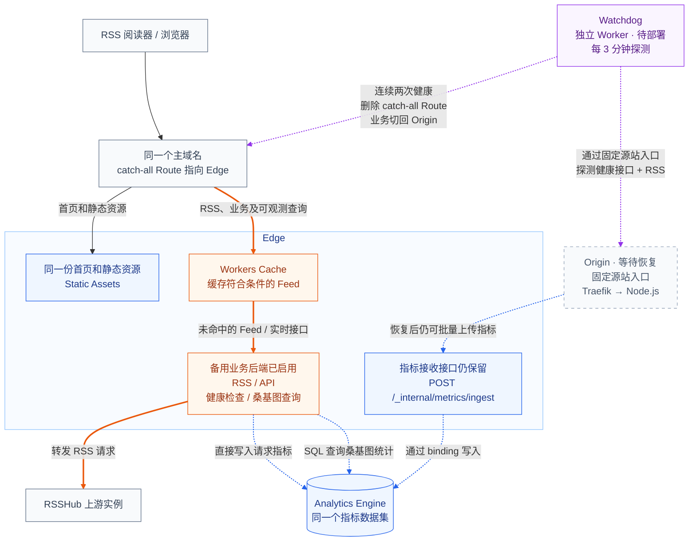

[rsshub-balancer](https://github.com/chesha1/rsshub-balancer) 现在采用 VPS 为主、Workers 为备用的架构：日常业务由 Oracle VPS 上的 Node.js 处理，Cloudflare 负责边缘入口、缓存、静态资源和备用后端。

这个项目负责给多个 RSSHub 实例做转发，优先找已有目标路由缓存的上游，失败了再换一个。现在用 Docker Compose 和 Traefik 部署。这里说的“云下”，就是从 Workers 搬到自己管理的常驻进程，机器当然还在云厂商那里。

# 为什么还要留着 Worker

在 [Cloudflare 的温柔陷阱](/posts/cloudflare-gentle-trap/) 里，我聊过托管后端的成本和运行时限制。把日常计算放到已有服务器上，可以减少 Workers CPU Time 和费用，也更方便维护 Redis 连接、内存缓存和后台任务。Cloudflare 继续提供入口、缓存和静态资源托管，Worker 后端则在 VPS 故障时临时承接业务。

下面两张图分别是正常和故障切换后的状态。Edge 包含业务 Worker 和 Static Assets，Origin 是 VPS 后端。绿色、橙色实线分别表示正常和备用业务路径，蓝色虚线是指标写入或查询，紫色虚线是 Watchdog 启用后的探测和路由修改。

**正常服务：Origin 处理业务，Edge 提供首页、静态资源和指标接收接口。**



健康检查、上游列表、缓存状态和桑基图查询都由当前业务后端返回；指标写入则始终经过 Edge。

**故障切换后：RSS、业务及可观测查询改由 Edge 处理，Watchdog 继续检查 Origin 是否恢复。**



首页、静态资源和指标接收接口始终属于 Edge。前端一直请求同域地址，业务切换时不用换 API 配置。Node 挂了，首页仍能打开，动态查询则要等备用后端开始处理请求后恢复。

# 一份业务代码，两种运行时

主备后端共用一份业务代码，保持 HTTP 路由和选路行为一致。

后端采用 Hono，`apps/origin` 和 `apps/edge` 共用 `packages/server-core`。共享包负责路由、选路和上游刷新，两个入口启动时各配置一次自己的 Redis 和指标实现，业务代码直接调用共享模块。

HTTP 转发统一使用 [Hono Proxy Helper](https://hono.dev/docs/helpers/proxy)，Node 通过 `@hono/node-server` 把请求交给 `app.fetch`。能共用的逻辑保持一份，真正需要分别处理的，是连接、状态和后台任务这些运行时差异。

# Redis：连接可以复用，状态需要分开

## 按运行时管理连接

Workers 的 TCP socket [不能在全局创建并跨请求共享](https://developers.cloudflare.com/workers/runtime-apis/tcp-sockets/#considerations)。所以 Worker 每次执行 Redis 命令时建连，结束后关闭；Node 则在进程内复用 client，HTTP 请求和定时刷新共用连接。

超时连接在在途操作收尾后重建，结果不明的写入不自动补发，避免重复提交。

## 同一个 Redis，两套健康判断

两端连接同一个 Redis / Valkey，但分别使用 `node:` 和 `worker:` 前缀。

Oracle 和 Cloudflare 到上游的网络可达性不同，需要各自维护健康判断。

两端独立探活、刷新列表、记录失败，切流时不用搬运或清空状态。首页展示当前后端实际使用的候选列表。

# 切流只动一条 Route

入口沿用 [Traefik + Cloudflare](/posts/traefik-cloudflare/)：DNS 橙云指向服务器，Traefik 转给 Node 容器，回源使用 Full (strict)。主域名不变，阅读器里的订阅地址也不用改。

正常时只保留三条指向业务 Worker 的 Route，负责首页、静态资源和指标接收：

```text
rsshub-balancer.virworks.moe/
rsshub-balancer.virworks.moe/_assets/*
rsshub-balancer.virworks.moe/_internal/metrics/ingest
```

其余业务回源 Node。需要切到 Worker 时，增加一条覆盖全部路径的规则：

```text
rsshub-balancer.virworks.moe/* -> rsshub-balancer
```

恢复 Node 时删掉它，DNS、证书和 Redis 状态都不用动。

# 下云以后，缓存继续留在边缘

日常回源使用 Zone Cache，Worker 承接业务时使用 Workers Cache。[两套缓存独立](https://developers.cloudflare.com/workers/cache/)，切换时不搬运条目。

普通 RSS 通过 Cache Rule 获得缓存资格，TTL 遵循源站缓存头；缓存键完整保留 query，因为参数可能改变订阅内容。健康检查和动态查询则统一返回：

```http
Cache-Control: no-store
Cloudflare-CDN-Cache-Control: no-store
```

# 指标还是留在 Analytics Engine

首页的桑基图继续使用 Analytics Engine。Node 没有 Worker 的指标 binding，就把事件放进内存队列，后台批量上传到 Edge 的 ingest 接口，再由 Worker 写入；Worker 自己处理业务时则直接写入同一数据集。

指标采用尽力上报，优先保证 RSS 转发。队列有上限，积压时丢旧数据，上传失败也丢掉这一批，避免重试造成重复计数。桑基图用于观察流量分布，允许少量指标丢失。

事件只保留原始访问的国家和最终尝试的上游，反映用户来源与选路结果。ingest 通过 WAF 仅允许服务器出口 IP 访问，payload 不带用户 IP、Cookie 或完整请求头。

桑基图统计进入选路流程的 RSS 请求，不包含 Cache HIT，并按 [`sum(_sample_interval)`](https://developers.cloudflare.com/analytics/analytics-engine/sampling/) 修正采样。批量上传减少 HTTP 请求次数，每条事件仍对应一个 data point。

# 故障切换得看业务真的能不能用

自动切换由独立的 `watchdog` Worker 负责。启用后每 3 分钟探测一次，不依赖业务 Redis，只负责检查服务和修改 Route。

健康判断包含上游探活和真实 RSS 请求两层。`/healthz` 要求至少一个上游返回 2xx，而且正文严格等于 `ok`。

Watchdog 还会检查应用来源标识，再请求 `/openai/news` 和 `/github/issue/DIYgod/RSSHub`。两条路由都要返回 200、正确的 XML 类型和完整合法的正文，至少有一篇标题、链接非空的文章。探测绕过边缘缓存，HTML 错误页、空 Feed、截断 XML 都算失败。

平时检查用户访问的主域名，同一轮连续两次失败就增加 catch-all；切到 Worker 后，改查不绑定 Worker 的固定 Origin 入口，连续两次健康才删掉规则。这样才能判断 Node 是否真的恢复。

Watchdog 通过 Routes API 增删规则并读回确认，每轮最多切换一次，下一轮重新评估业务状态。故障发现与恢复速度取决于探测周期和路由传播时间。

主备后端共享 Redis 和部分 RSSHub 上游，因此这套方案主要覆盖 balancer 运行环境的故障，共同依赖仍需要单独保障。

日常计算和连接放在常驻进程，Cloudflare 提供入口、缓存、静态资源和备用执行。对这个小项目来说，利用已有服务器，再留一条容易操作的退路，就已经很够用了。完整方案见 [架构文档](https://github.com/chesha1/rsshub-balancer/tree/eb152db63c37318f10f3fd5b0145bbe87f9b0ad1/docs/worker-migration)。

# 结果

随着使用人数增加，rsshub-balancer 在 Cloudflare Workers 上的调用量持续增长。下图所选的近 30 天里，Worker 累计被调用约 **603 万次**，日均约 **20 万次**。当时大半个月就用完了 Workers Paid 套餐内包含的 CPU Time 额度。


迁到 VPS 后，同样的服务持续运行时，CPU 占用不到 0.1 核。下图橙色曲线对应 rsshub-balancer，内存工作集稳定在 **100 MiB 左右**，悬浮读数为 **102 MiB**。对已有空余资源的服务器来说，这点负担很轻。


我原本以为 Cloudflare 的付费套餐是性价比之选，现在看来，对于这种计算量不大、持续有流量的小服务，也未必便宜。既然自己的服务器能轻松承接，把日常业务放回 VPS，对我来说更合算。
