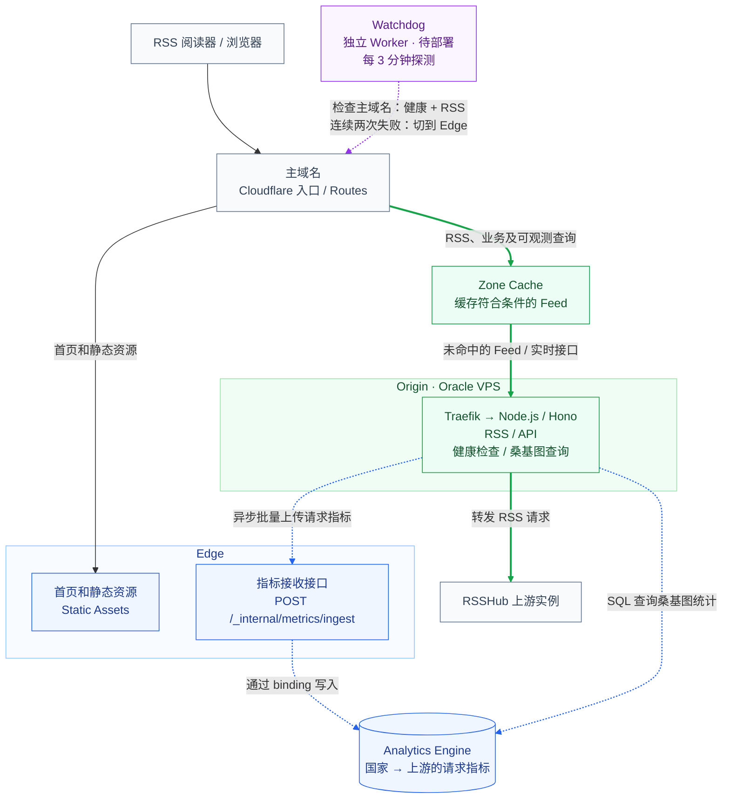
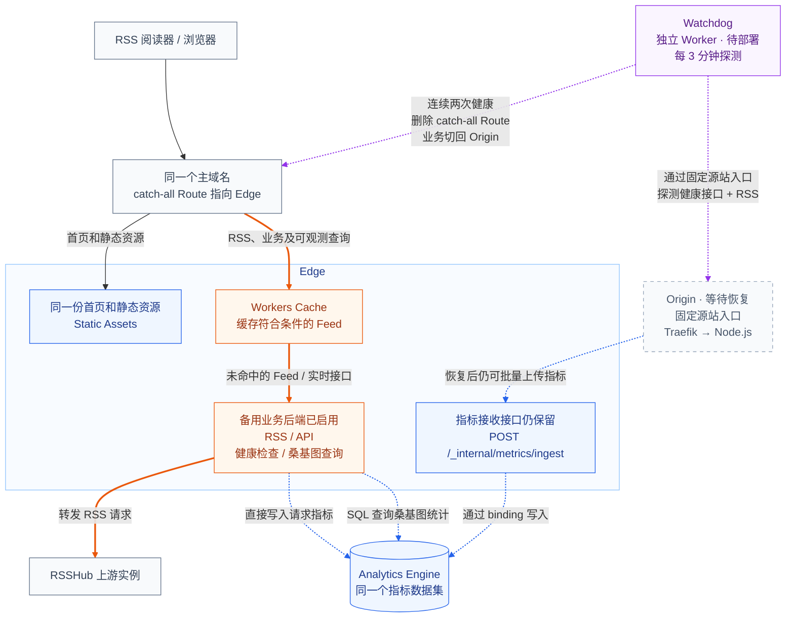

[rsshub-balancer](https://github.com/chesha1/rsshub-balancer) 是我用来给多个 RSSHub 实例做转发的小工具：请求进来后，优先挑已经有目标路由缓存的上游，失败了再自动换下一个。

之前它完全跑在 Cloudflare Workers 上，现在我把它改成了 VPS 为主、Workers 兜底的结构——日常请求由 Oracle VPS 上的 Node.js 常驻进程处理，通过 Docker Compose 和 Traefik 部署；Cloudflare 则留在最前面负责边缘入口、缓存、静态资源，并在 VPS 挂掉时临时接管后端业务。

# 为什么还要留着 Worker

在 [Cloudflare 的温柔陷阱](/posts/cloudflare-gentle-trap/) 里，我聊过把后端全塞进 Cloudflare 之后遇到的账单问题和运行时限制。把日常计算挪回手头本来就空着的 VPS 上，一方面能省下不少 Workers CPU Time 和超额费用，另一方面有个常驻进程，维护起 Redis 长连接、内存缓存和后台任务也顺手得多。

至于为什么没把 Worker 彻底拆掉，主要是因为现成的代码本来就能在 Workers 上跑，留作故障兜底几乎没有额外维护成本；而且首页静态资源和 Analytics Engine 指标写入继续放在边缘也很方便。

下面两张图分别是平时和故障切换后的流量走向。图里的 Edge 包含业务 Worker 和 Static Assets，Origin 就是 VPS 上的 Node 后端。绿色和橙色实线分别代表平时和切流后的业务路径，蓝色虚线是指标读写，紫色虚线则是 Watchdog 启用后的健康探测和路由切换。

**正常服务：Origin 处理核心业务，Edge 负责首页、静态资源和接收监控指标。**



健康检查、上游列表、缓存状态和首页的桑基图数据，都由当前正在干活的业务后端直接返回；只有指标写入是一直经过 Edge 的（因为要调 Workers 的 binding）。

**故障切换后：RSS 转发及各类查询改由 Edge 接管，同时 Watchdog 在后台盯着 Origin 是否恢复。**



不管后端怎么切，首页、静态资源和指标接收接口始终留在 Edge，前端也一直请求同域名的接口，切换时不用改任何配置。哪怕 VPS 上的 Node 彻底挂了，首页依然能正常打开，上面展示的动态数据只要等备用 Worker 接管请求后就能恢复。

# 一份业务代码，两种运行时

既然做主备切换，两边跑的业务逻辑肯定得保持一致，我也不想维护两套差不多的代码。

好在后端本来就是用 Hono 写的，跨运行时很方便。仓库里拆成了 `apps/origin` 和 `apps/edge` 两个入口，核心的路由、选路和上游刷新逻辑全放在共享的 `packages/server-core` 里。HTTP 转发统一用 [Hono Proxy Helper](https://hono.dev/docs/helpers/proxy)，Node 这边只需要通过 `@hono/node-server` 把请求转交给 `app.fetch` 就行。

两个入口在启动时各自注入自己的 Redis 客户端和指标上报实现，上层业务代码直接调共享模块。这样业务逻辑只用维护一份，真正需要区分对待的，只有连接管理、状态隔离和后台任务这些运行时差异。

# Redis：连接可以复用，状态需要分开

## 按运行时管理连接

因为 Workers 的 TCP socket [不能在全局创建并跨请求共享](https://developers.cloudflare.com/workers/runtime-apis/tcp-sockets/#considerations)，所以 Worker 这边只能每次执行 Redis 命令时现建连接，用完即关；到了 Node 这边就省事多了，进程内可以直接复用同一个 client，日常 HTTP 请求和后台定时刷新走的都是同一条连接。

当然，常驻连接就得自己处理断线重连。如果遇到连接超时，Node 端会等手头正在跑的操作收尾后再重建连接；对于超时后不确定有没有写成功的操作，则直接放弃、不自动补发，避免重复写入。

## 同一个 Redis，两套健康判断

虽然主备后端连的是同一个 Redis / Valkey 实例，但两边在 key 上分别加了 `node:` 和 `worker:` 前缀来隔离。

原因很简单：Oracle VPS 和 Cloudflare 边缘节点到各个 RSSHub 上游的网络情况不太一样——VPS 连得通的实例，Worker 未必连得通，反过来也是。所以两边必须各自维护一套健康判断。

平时两端各自独立探活、刷新列表、记录失败，互不干扰。这样在故障切流的时候，不需要搬运或者清空 Redis 里的状态，切过去就能直接用；首页上展示的也是当前后端实际在用的那份候选列表。

# 切流只动一条 Route

流量入口继续沿用之前的 [Traefik + Cloudflare](/posts/traefik-cloudflare/) 方案：DNS 开橙云指向服务器，开启 Full (strict) 回源，再由 Traefik 把请求转给 Node 容器。主域名不变，阅读器里已经订好的地址也不用改。

正常情况下，Cloudflare 这边只保留三条指向业务 Worker 的 Route，用来处理首页、静态资源和指标接收：

```text
rsshub-balancer.virworks.moe/
rsshub-balancer.virworks.moe/_assets/*
rsshub-balancer.virworks.moe/_internal/metrics/ingest
```

除此之外的请求全部回源到 VPS 上的 Node。需要切到 Worker 时，只要加一条覆盖全部路径的兜底规则：

```text
rsshub-balancer.virworks.moe/* -> rsshub-balancer
```

等 Node 恢复正常，再把这条规则删掉就行，DNS、证书和 Redis 状态全都不用动。

# 下云以后，缓存继续留在边缘

虽然计算搬回了 VPS，但缓存还是留在 Cloudflare 边缘。平时回源走的是 Zone Cache，切到 Worker 兜底时则走 Workers Cache。[这两套缓存本身是相互独立的](https://developers.cloudflare.com/workers/cache/)，切换时也不需要搬运缓存条目，直接各自重新预热就行。

普通的 RSS 请求通过 Cache Rule 开启边缘缓存，TTL 跟着源站返回的缓存头走；同时因为 query 参数往往会影响订阅输出的内容，缓存键保留了完整的查询参数。至于健康检查和前端的动态状态查询，则统一返回禁止缓存的响应头：

```http
Cache-Control: no-store
Cloudflare-CDN-Cache-Control: no-store
```

# 指标还是留在 Analytics Engine

首页用来看流量走向的桑基图，底层数据继续存在 Analytics Engine 里。只不过 Node 没有 Worker 的指标 binding，没法直接写，所以 Node 端会先把事件放进内存队列，后台攒够一批再发给 Edge 的 ingest 接口，由 Worker 代为写入；等到故障切换、Worker 自己处理业务时，就直接调 binding 写进同一个数据集里。

这套指标上报走的是“尽力而为”的策略，一切以保证正常的 RSS 转发为前提。内存队列设了上限，真要积压了就丢掉旧数据；批量上传要是失败了也不重试，直接丢掉这一批，免得重试造成重复计数。反正桑基图只是用来看个大概的流量分布，丢一点数据完全可以接受。

每条事件只保留请求来自哪个国家、最终落到了哪个上游实例，用来看用户来源和选路结果就够了，payload 里不带用户 IP、Cookie 或完整请求头。Edge 上的 ingest 接口也通过 WAF 限制了只允许 VPS 的出口 IP 访问。

另外，桑基图统计的只是真正进入后端选路流程的 RSS 请求，不包含直接在边缘命中的 Cache HIT，查询时还会按 [`sum(_sample_interval)`](https://developers.cloudflare.com/analytics/analytics-engine/sampling/) 做采样修正。Node 端批量上传只是为了减少 HTTP 请求次数，落到 Analytics Engine 里依然是每条事件对应一个 data point。

# 故障切换得看业务真的能不能用

自动切流由一个独立的 `watchdog` Worker 负责。启用后每 3 分钟探测一次，它本身不连业务的 Redis，只负责检查服务状态和调用 API 修改 Route。

之所以说要看“业务真的能不能用”，是因为光靠一个轻量接口很容易误判。所以健康判断分成了上游探活和真实 RSS 请求两层：先查 `/healthz`，要求至少有一个上游返回 2xx 且正文严格等于 `ok`；接着还要核对应用来源标识，再去实际请求 `/openai/news` 和 `/github/issue/DIYgod/RSSHub` 这两条路由。

探测请求会绕过边缘缓存，要求两条路由都必须返回 200、正确的 XML 类型以及完整合法的正文，并且里面至少能解析出一篇标题和链接非空的文章。无论是碰到 HTML 错误页、空 Feed 还是截断的 XML，都会直接判为失败。

探测的目标地址也会跟着当前状态切换：

- **平时跑在 VPS 上时**：直接检查用户访问的主域名，同一轮里连续两次失败，就加上 `/*` 的 catch-all 规则切到 Worker。
- **切到 Worker 之后**：如果继续查主域名，测出来的其实是备用的 Worker 自己。所以这时会改查一个不绑定 Worker、直通 VPS 源站的固定入口，只有连续两次探测恢复健康，才会把 catch-all 规则删掉，让流量切回 Node。

Watchdog 每次通过 Routes API 增删规则后都会再读回确认一次，而且每轮最多只切换一次，留到下一轮再重新评估，避免状态抖动。

当然，因为主备后端共用同一个 Redis 和部分 RSSHub 上游，这套方案主要兜底的是 balancer 自身运行环境的故障。更完整的细节可以翻仓库里的[架构文档](https://github.com/chesha1/rsshub-balancer/tree/eb152db63c37318f10f3fd5b0145bbe87f9b0ad1/docs/worker-migration)。

# 结果

当初决定动手搬家，最直接的原因还是调用量涨上来了。随着使用人数增加，下图截取的近 30 天里，Worker 累计被调用了约 **603 万次**，日均约 **20 万次**。当时才过了大半个月，Workers Paid 套餐里包含的 CPU Time 额度就已经见底了。


搬到 VPS 之后，同样的流量跑在常驻进程里，CPU 占用连 0.1 核都不到。下图橙色曲线对应 rsshub-balancer，内存工作集一直稳定在 **100 MiB 左右**（悬浮读数为 **102 MiB**）。对于一台本来就有空余资源的服务器来说，这点负担几乎可以忽略不计。


我以前一直觉得 Cloudflare 的付费套餐很有性价比，现在实际跑下来看，对于这种单次计算量不大、但持续有流量的小服务，全放在 Workers 上也未必便宜。既然手头的服务器就能轻松扛住，把日常业务放回 VPS，只让 Cloudflare 负责入口、缓存、静态资源和故障兜底，对我来说显然划算得多。
